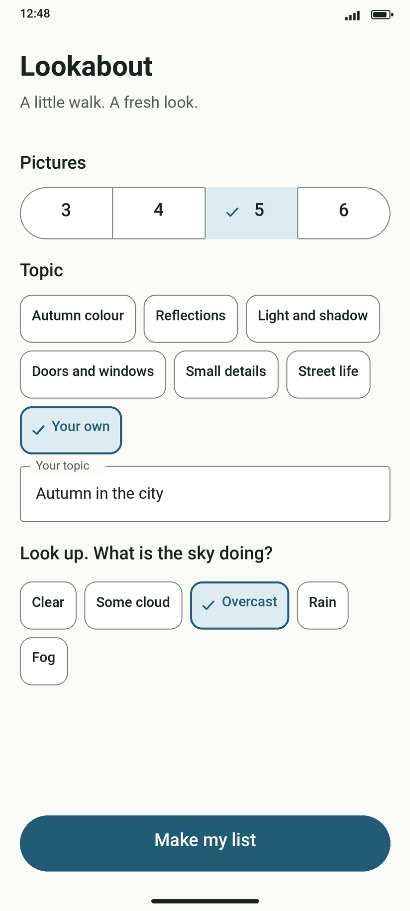
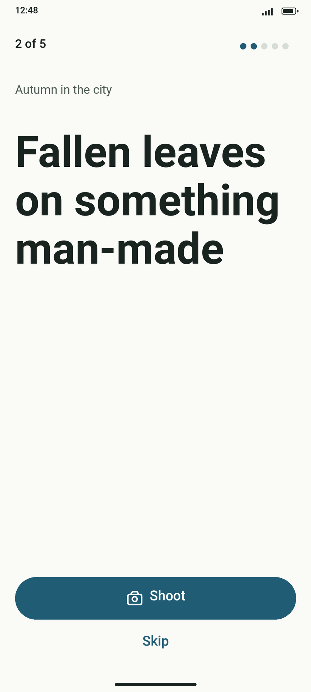
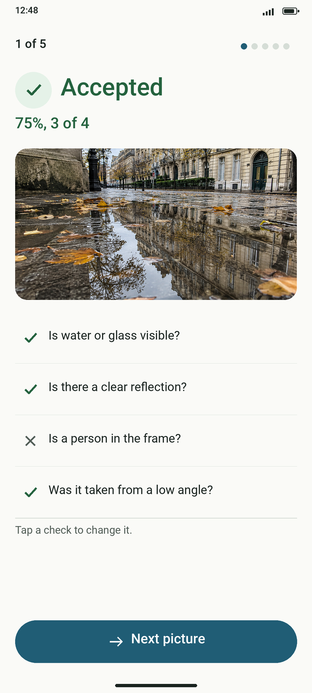
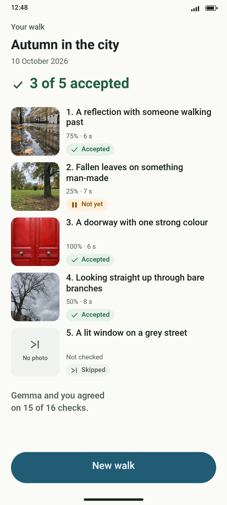
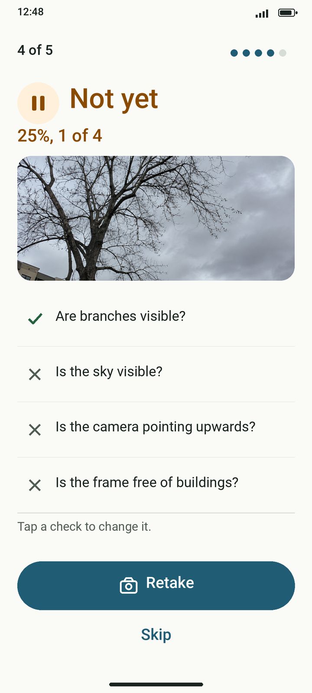
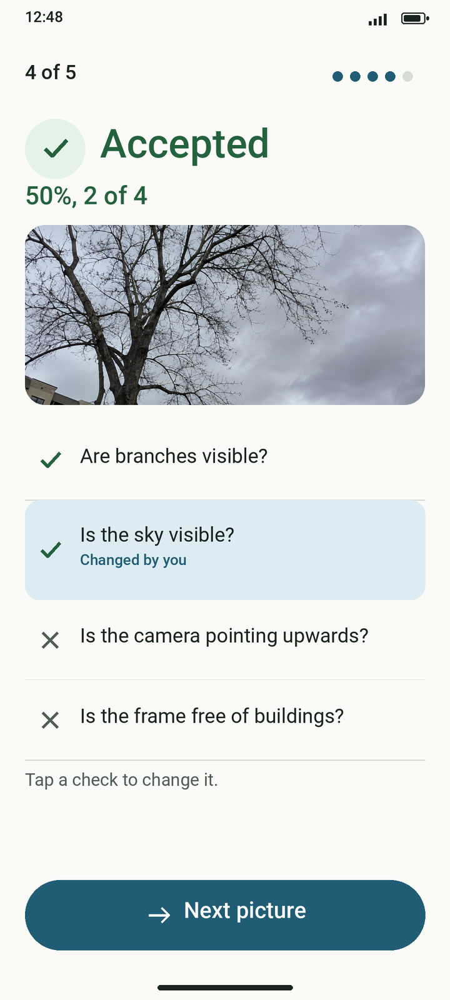

# Lookabout

Lookabout is an Android app for photo walks. It sets a challenge of 3 to 6 pictures to find on a walk, and checks each photo on the phone with Gemma 4 E2B, offline. It is for anyone who wants a reason to go outside and look around more closely.

An entry for the Hacktoberfest Open-Source AI Challenge, Week 1: Touch Grass.

<p>
  
  
  
  
</p>

*The designer's screens, with sample photos. Screenshots from a real walk will follow.*

## How to use Lookabout

1. **Get the model.** The first time, Setup shows **Download the model (2.6 GB)**. Connect to Wi-Fi and tap it. The progress shows above the button, such as "Downloading the model: 42%", and **Cancel** stops it. The download goes on when you close the app. To push the file with adb instead, see [Put the model on the phone](#put-the-model-on-the-phone).
2. **Wait for the model.** While it loads, the button reads **Getting the model ready**. If it cannot load, Setup says "Couldn't get the model ready." with **Try again**.
3. **Choose on Setup.** Pick how many **Pictures** (3 to 6) and a **Topic**, or tap **Your own** and type one. Under **Look up. What is the sky doing?**, tap the sky you see. Tap **Use my location for the light** once if you want the list to fit where the sun is. Then tap **Make my list**; it works once a sky is chosen.
4. **Read your list.** "Making your list" shows while Gemma writes. Then **Your list** shows every picture to find. Tap **New list** for other pictures, or **Start walk**. On Android 13 and later, Start walk asks once whether Lookabout may post notifications.
5. **Find a picture.** The screen shows where you are, such as "2 of 5", and the picture to find. Tap **Shoot** to open the camera app and take the photo. **Skip** moves on without one.
6. **Wait for the check.** **Checking** shows while Gemma answers four yes/no questions about the photo; as the screen says, "You can keep looking around."
7. **Read the verdict.** **Accepted** or **Not yet**, with the share of YES answers ("75%, 3 of 4"), the photo and the four checks. The phone buzzes: one long pulse for Accepted, two short ones for Not yet.
8. **Fix a wrong answer.** Tap a check to change it; it then says "Changed by you" and the verdict follows. Tap it again to restore Gemma's answer.
9. **Move on.** After Accepted, tap **Next picture**. After Not yet, tap **Retake** for a new photo, or **Skip** to keep this one and move on. If the check fails, **Check paused** says "Couldn't check this photo." with **Try again** and **Skip**.
10. **Finish.** On the last picture the button reads **Finish walk**, and Skip finishes too.
11. **See the results.** **Summary** shows the topic, the date, how many pictures were accepted, and each photo with its result: **Accepted**, **Not yet**, **Skipped** or **Not checked**. Under them, a line says how often you and Gemma agreed. **Check again** checks the photos marked Not checked once more. **New walk** goes back to Setup.
12. **Look back.** Once a walk is done, **Past walks** shows at the top of Setup. Tap a walk to open its Summary, and **Back** to return. Long-press a walk to delete it: "Delete this walk? Its photos stay in the gallery." with **Delete** and **Keep**. **Back to Setup** leaves the list.

<p>
  
  
</p>

*Step 8 in the designer's screens: one tap on a wrong check turns Not yet into Accepted.*

Along the way:

- **Lock screen**: during a walk, a silent notice shows the current picture and "2 of 5", also on the lock screen. Tap it to go back to the walk, straight into the camera when the picture still needs its photo. Without the notification permission from step 4 there is no notice.
- **Gallery**: every photo is also copied to the phone's gallery, in `Pictures/Lookabout`, to edit and share from there.
- **Check photos at the end**: turn this on in Setup to shoot without waiting. After Shoot, **Photo taken** says "Checked at the end of the walk." with **Next picture** and **Retake**. At **Finish walk** every photo is checked one after another ("Checking 2 of 5"), then Summary opens.
- **Debug screens**: long-press the **Lookabout** title on Setup (see [Debug screens](#debug-screens)).

## How it works

Gemma writes the pictures from the topic, the sky, the time of day and the month, each with four yes/no questions. If you allowed location, the prompt also gets a line saying where the sun is, such as "low in the south-west", worked out on the phone from the last known coarse location; the location is not stored. Any gap is filled from a built-in list, which is also used alone when the model is not loaded.

A photo with two or more YES answers is accepted. The coverage on Summary is the share of YES answers, next to how long the check took. The agreement line counts the answers you left unchanged.

With **Check photos at the end** on, the walk does not wait for Gemma. If the model is not ready at Finish walk, the check waits for it ("Getting the model ready") and starts by itself once it is. A model that failed to load is tried once more; if it is not on the phone or still fails, **Show results now** opens Summary without the check. A photo whose check fails shows **Not checked** on Summary, where **Check again** checks it once more.

The walk is saved on the phone after every change, so it survives Android closing the app while the camera is open: the app opens where you left off and checks a photo taken in the meantime. With **Check photos at the end** on, that photo is checked at **Finish walk** with the others instead, and a walk closed during the check at the end picks it up again.

Everything runs on the phone. Downloading the model is the only time the app goes online; the lists, the photos and the photo checks never leave the phone.

## Permissions

- **Internet** (`INTERNET`): to download the model, once, over Wi-Fi.
- **Vibration** (`VIBRATE`): to buzz the verdict when a photo is checked during the walk.
- **Approximate location** (`ACCESS_COARSE_LOCATION`, optional, asked from Setup): to work out where the sun is for the list. Without it the list is written without the sun line.
- **Notifications** (`POST_NOTIFICATIONS`, optional, asked once at Start walk on Android 13 and later): for the lock-screen notice during a walk.

The camera app takes the photos, so Lookabout needs no camera permission, and copying photos to `Pictures/Lookabout` needs no storage permission.

## Build

Needs JDK 17 or newer and the Android SDK (platform 37), with `ANDROID_HOME` set. Open the project in Android Studio, or build from the command line:

```sh
./gradlew assembleDebug test
```

The debug APK lands in `app/build/outputs/apk/debug/`. Every push to `main` and every pull request is also built on GitHub Actions, which keeps the APK as a download on the run (`lookabout-debug-apk`).

The app needs a real phone on Android 12 or later (minimum SDK 31).

## Put the model on the phone

The app downloads the model itself: without it, Setup offers **Download the model (2.6 GB)**. The download runs through Android's download manager on Wi-Fi only, shows a notification and keeps going if the app is closed. When it is done, the file moves into the app's own files folder and the model loads.

During development you can push it instead. Download the single file `gemma-4-E2B-it.litertlm` (2.58 GB) from <https://huggingface.co/litert-community/gemma-4-E2B-it-litert-lm>, then, with the phone connected over USB debugging, run:

```text
adb shell mkdir -p /data/local/tmp/llm
adb push gemma-4-E2B-it.litertlm /data/local/tmp/llm/
```

The app first looks for `gemma-4-E2B-it.litertlm` in its own files folder, then in `/data/local/tmp/llm/`. Never commit the model file to the repository.

On phones with 12 GB of memory or more, the debug screen also offers the larger Gemma 4 E4B: push `gemma-4-E4B-it.litertlm` (3.66 GB) from <https://huggingface.co/litert-community/gemma-4-E4B-it-litert-lm> with the same commands (`adb push gemma-4-E4B-it.litertlm /data/local/tmp/llm/`). The in-app download is E2B only.

## Debug screens

A long press on the Lookabout title on Setup opens the debug screen, with a model test and the photo check. The model loads on the GPU with speculative decoding (multi-token prediction) when it can, else on the GPU without it, else on the CPU; the model test shows the backend and whether speculative decoding is on. On phones with 12 GB of memory or more (Android reports at least 11 GiB) it also lets you choose between Gemma 4 E2B (the default) and Gemma 4 E4B; the choice is remembered, and if the E4B file is missing the app says so and stays on E2B.

## Licence

[Apache License 2.0](LICENSE)

## Credits

- [Gemma 4](https://ai.google.dev/gemma) by Google, the model that checks the photos, under Apache-2.0.
- [LiteRT-LM](https://github.com/google-ai-edge/LiteRT-LM) by Google, which runs the model on the phone, under Apache-2.0.
- [Coil](https://github.com/coil-kt/coil), for showing photos, under Apache-2.0.
- [Jetpack Compose and AndroidX](https://developer.android.com/jetpack), under Apache-2.0.

## Changes after the deadline
